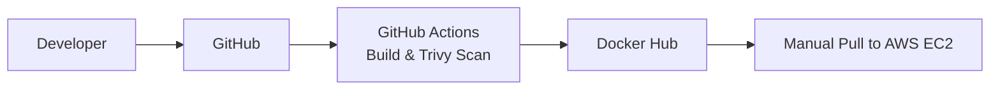

<div align="center">

</div>

# Run and deploy your AI Studio app

This contains everything you need to run your app locally.

View your app in AI Studio: https://ai.studio/apps/temp/1

## Run Locally

**Prerequisites:**  Node.js


1. Install dependencies:
   `npm install`
2. Set the `GEMINI_API_KEY` in [.env.local](.env.local) to your Gemini API key
3. Run the app:
   `npm run dev`

## DevOps & CI/CD Architecture

The project uses GitHub Actions to verify the frontend, build and scan its production
container, and publish the image to Docker Hub. Deployment to an AWS EC2 instance is
intentionally manual.



### Required GitHub Secrets

Configure these repository secrets under **Settings → Secrets and variables → Actions**:

- `DOCKERHUB_USERNAME` — Docker Hub username used in the image tag.
- `DOCKERHUB_TOKEN` — Docker Hub access token used to authenticate image pushes.

### Manual EC2 Deployment

After installing Docker on the EC2 instance, pull and run the latest image:

```bash
docker pull <username>/ai-fitness-agent:latest
docker run -d -p 80:80 <username>/ai-fitness-agent:latest
```

## Deployment troubleshooting and verified project status

GitHub Pages and Docker are separate delivery paths. A green Pages deployment
means static assets were uploaded; it does not prove that React rendered or that
a Docker image was pushed.

### Current evidence (23 October 2026)

The upstream Docker run [37811952430](https://github.com/S1A2T00/AI_FITNESS-agent-by-Satyam/actions/runs/37811952430)
passed dependency installation, Vite build, Docker build, Trivy scanning and
Docker Hub login. Its push failed with
`unauthorized: access token has insufficient scopes`.
The upstream Pages deployment passed, but its browser application crashed because
the Gemini SDK was initialized at module import without an API key.
The fork had no workflow runs when inspected.

### Fixes

- Create the Gemini client only when an AI feature is used. An unconfigured
  dashboard still renders; AI features report a configuration error.
- Use an empty string fallback for missing build-time API keys.
- Use `VITE_BASE_PATH=/` for local/Docker builds. Pages supplies
  `/<repository-name>/`, so renamed forks receive the right asset URLs.
- Build with Node.js 24 and `npm ci`, using the committed lockfile.
- Validate Nginx and the generated JavaScript URL before scanning/publishing.
- Build and scan pull requests without registry credentials. Publish only
  main/master pushes or manual runs on those branches, using both commit SHA
  and `latest` tags. No cloud deployment is performed.
- This repository currently has no lint or test scripts. CI only runs these
  commands if they are added; the Vite build is not an application test suite.

### Local development

Use Node.js 24, then run:

```powershell
npm.cmd ci
Copy-Item .env.example .env.local
# Edit .env.local privately if Gemini is needed.
npm.cmd run dev
```

Restart Vite after changing `.env.local`. Never commit real keys.

### API key limitation

This app calls Gemini directly from the browser. Vite's `define` substitution
embeds any supplied key in browser JavaScript; neither an ignored env file nor a
GitHub Secret makes that bundled value secret. The public Pages workflow therefore
publishes a dashboard demo without a Gemini key. The Docker image also builds
without an env file or key.

A static Nginx container cannot apply `docker run -e GEMINI_API_KEY=...` to an
already-built Vite bundle. Do not pass a key as a Docker build argument: it would
become readable in the generated assets. To offer Gemini securely to public users,
a server-side API/proxy is required. That architecture change is outside this fix.
Local development with a personal key remains available.

### Build and run Docker locally

Start Docker Desktop and wait for its engine to become ready. From the project root:

```powershell
docker build -t ai-fitness-agent:local .
docker run -d --name ai-fitness-local -p 127.0.0.1:8080:80 ai-fitness-agent:local
docker ps --filter name=ai-fitness-local
docker logs ai-fitness-local
```

Open http://localhost:8080. The dashboard should render without a key.
AI responses require the separate API configuration described above.

To stop/remove this test container and rebuild after edits:

```powershell
docker stop ai-fitness-local
docker rm ai-fitness-local
docker build -t ai-fitness-agent:local .
```

### Fix Docker Hub publishing

1. Ensure `DOCKERHUB_USERNAME` is the actual Docker Hub username, not an email
   address or GitHub username.
2. Create a Docker Hub personal access token with repository **Read & Write**
   access. The account must have push rights to `<username>/ai-fitness-agent`.
   A token that permits login/pull can still fail on push.
3. In this fork, open Settings → Secrets and variables → Actions. Set
   `DOCKERHUB_USERNAME` and `DOCKERHUB_TOKEN`. Forks do not inherit the
   upstream repository's secret values.
4. Enable Actions in this fork if prompted, merge the reviewed fix, and rerun
   Docker CI/CD on `master`.
5. Verify both `latest` and the commit SHA tag on Docker Hub. Do not claim
   publishing succeeded until that run's push step passes.

The token value must not appear in source files, screenshots, issue comments, or
chat messages.

### GitHub Pages demo

Configure Settings → Pages → Source as GitHub Actions if Pages is desired.
After the fix is merged into `master`, run the Pages workflow and open its
deployment URL. For this fork the repository subpath is `/AI_FITNESS-AGENT/`.
GitHub Pages does not run the Docker container.

### Scan coverage

Trivy fails CI for fixable HIGH/CRITICAL findings in the final image.
Because the final image contains Nginx and compiled browser assets rather than
`node_modules`, a clean image scan is not evidence that all frontend npm
dependencies are free of vulnerabilities. Review `npm audit` separately;
dependency remediation is not included in this startup fix.
