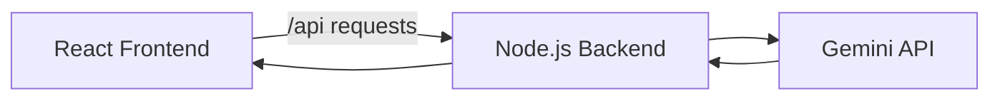
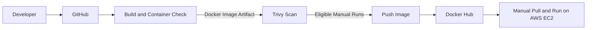

<div align="center">

</div>

# Vitalis AI — Health & Fitness Agent

Originally prototyped in Google AI Studio, Vitalis AI now uses a Vite + React
frontend and a Node.js backend for Gemini-powered health analysis and AI Coach
responses.

The backend handles Gemini API requests and serves the production frontend.
The Gemini API key is supplied to the backend at runtime.

## Architecture



Google AI Studio was used for the original prototype. The current application
calls the Gemini API through its backend; it does not require an AI Studio
browser tab to remain open.

## Requirements

- Node.js 24 and npm for local development.
- A valid Gemini API key with access to the models in `constants.ts`.
- Docker Desktop or Docker Engine for container testing.

## Local Development

Run commands from the repository root, where `package.json` is located.
On Windows PowerShell, use `npm.cmd`; on macOS/Linux, use `npm`.

### 1. Install dependencies

```powershell
npm.cmd ci
```

### 2. Configure the API key

If `.env.local` does not already exist, create it:

```powershell
Copy-Item .env.example .env.local
```

Edit `.env.local` privately:

```dotenv
GEMINI_API_KEY=your_actual_key
```

Do not overwrite an existing environment file containing your key.
The backend requires a nonempty `GEMINI_API_KEY` to start.

### 3. Start the backend

In the first terminal:

```powershell
npm.cmd run dev:api
```

The backend runs at http://127.0.0.1:3001/.

### 4. Start the frontend

In a second terminal, from the same project directory:

```powershell
npm.cmd run dev
```

Open http://127.0.0.1:3000/.

Vite proxies `/api` requests to the backend on port 3001.
Restart the backend after changing `.env.local`.

## Production Build Without Docker

Stop any development backend already using port 3001, then run:

```powershell
npm.cmd run build
npm.cmd start
```

Open http://127.0.0.1:3001/.

The Node server serves both the compiled frontend and API.
`npm run preview` previews the frontend; it does not replace the backend.

## API Key Handling

- Gemini requests run in `server/index.mjs`.
- The frontend calls `/api/coach` and `/api/analyze`.
- The API key is not substituted into the frontend bundle.
- `.env.local` is ignored by Git.
- Environment files are excluded from the Docker build context.
- Supply the key at runtime, not through Docker build arguments.
- Never commit real credentials or print them in workflow logs.

Server-side key storage does not authenticate API callers. Public deployment
requires appropriate access controls and rate limiting to protect API usage.

## Docker

The multi-stage Dockerfile builds the frontend and packages it with the Node.js
backend and production dependencies.

The production container:

- Uses Node.js 24.
- Runs as the non-root `node` user.
- Serves the application on port `3001`.
- Starts Node directly; npm is removed after dependency installation.
- Does not use Nginx.

Start Docker Desktop or Docker Engine before running these commands.

### Build and Run Local Source

From the project root:

```powershell
docker build --pull -t ai-fitness-agent:local .
docker run -d --name fitness-local --env-file .env.local -p 127.0.0.1:8083:3001 ai-fitness-agent:local
```

Open http://127.0.0.1:8083/.

### Run the Published Image

The current fork publishes to `sameer8765/ai-fitness-agent`.
Other publishers should substitute their configured Docker Hub repository.

```powershell
docker pull sameer8765/ai-fitness-agent:latest
docker run -d --name fitness-published --env-file .env.local -p 127.0.0.1:8084:3001 sameer8765/ai-fitness-agent:latest
```

Open http://127.0.0.1:8084/.

The port mapping connects laptop port `8084` to container port `3001`.
Binding to `127.0.0.1` limits access to the local computer.

### Verify the Application

1. Open the dashboard and confirm that it renders.
2. Refresh the page and confirm that it still renders.
3. Send a message through AI Coach and check the response.
4. Open http://127.0.0.1:8084/api/health.

Expected health response:

```json
{"status":"ok"}
```

The health endpoint checks the server. It does not validate Gemini credentials,
model access, or quota.

### Container Management

Run the following commands as needed:

```powershell
docker ps -a --filter name=fitness-published
docker logs --tail 100 fitness-published
docker stop fitness-published
docker start fitness-published
```

`docker run` creates a new container. `docker start` starts an existing stopped
container. Container names and host ports must be available.

Pulling a new image does not update an existing container. To test the newly
pulled image, create a new container using an available name and host port, or
stop and remove the old test container before recreating it.

Removing a container discards its container-local writable data.

## DevOps & CI/CD Architecture

Workflow file: `.github/workflows/docker-ci.yml`.



### Workflow Jobs

| Job | Responsibilities |
| --- | --- |
| Build | Install dependencies, run optional lint/test scripts, build the frontend and Docker image, check backend health and root HTML, and upload the saved image. |
| Scan | Download and load the same Docker image, then run Trivy. |
| Push | After Scan passes, publish commit-SHA and `latest` tags to Docker Hub. |

The Docker image is built once and transferred between jobs using a workflow
artifact. The artifact is retained for one day.

### Triggers

- Pull requests targeting `master` or `main` run Build and Scan.
- Push is intentionally skipped on pull requests.
- Manual runs on `master` or `main` run all three jobs.
- Manual runs on other branches do not publish images.
- Normal Git pushes do not directly trigger this workflow.
- Updating an open pull request triggers its PR checks.

### Run the Workflow Manually

1. Commit and push the intended changes.
2. Open the repository's **Actions** tab.
3. Select **Docker CI/CD**.
4. Click **Run workflow**.
5. Select `master` or `main`.
6. Start the run and check the Build, Scan, and Push jobs.

Start a new run to test new commits. Re-running an old run uses that run's
original commit.

### Required GitHub Secrets

Configure these in the repository that publishes images, under
**Settings → Secrets and variables → Actions**:

| Secret | Purpose |
| --- | --- |
| `DOCKERHUB_USERNAME` | Docker Hub username used for the image repository. |
| `DOCKERHUB_TOKEN` | Token with repository Read & Write access. |

Forks and upstream repositories have separate secrets. Configuring secrets in a
fork does not configure the upstream repository.

### Validation and Scan Coverage

The CI container check uses a placeholder API key. It checks server startup,
the health endpoint, and root HTML; it does not call Gemini or run a browser.

Trivy scans the final image for OS and library vulnerabilities and blocks
fixable HIGH/CRITICAL findings. The workflow uses `ignore-unfixed: true`, so
findings without fixes do not block publishing.

A passing scan does not guarantee that no vulnerabilities exist.
Review application and development dependencies separately:

```powershell
npm.cmd audit
```

There are currently no lint or test scripts in `package.json`.
The optional workflow steps do not constitute an application test suite.

## Deployment Status

The workflow publishes a Docker image. It does not deploy a public website.

The published image has been tested locally for frontend rendering and an actual
AI Coach response. Public server deployment remains pending.

### GitHub Pages

The current application requires a Node.js backend, which GitHub Pages cannot run.
The old Pages workflow has been removed.

A previous successful Pages deployment does not validate the current backend-based
application. Its old website URL does not host the current full application.

### Manual AWS EC2 Container Setup

On an EC2 host with Docker installed, create a private `.env.local` file containing
`GEMINI_API_KEY`. Substitute your publisher's image repository where necessary.

```bash
chmod 600 .env.local

docker pull sameer8765/ai-fitness-agent:latest

docker run -d --name ai-fitness-agent \
  --restart unless-stopped \
  --env-file .env.local \
  -p 127.0.0.1:3001:3001 \
  sameer8765/ai-fitness-agent:latest

curl --fail http://127.0.0.1:3001/api/health
```

This binds the application to the EC2 host's loopback interface.

For public access, configure a reverse proxy with HTTPS, appropriate security-group
rules, API access controls, and rate limiting. The container command above does
not configure these services or create a public website URL.

## Troubleshooting

| Problem | Check |
| --- | --- |
| Missing API key | Set `GEMINI_API_KEY` in the backend's runtime environment. |
| Frontend build missing | Run `npm run build` before `npm start`, or rebuild the image. |
| AI request failed | Check key validity, model access, and quota. |
| White screen | Inspect the browser console, network requests, and container logs. |
| Container name conflict | Inspect the existing container before creating another. |
| Port already allocated | Stop the conflicting process or choose another host port. |